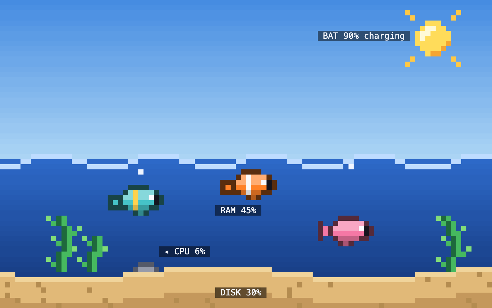
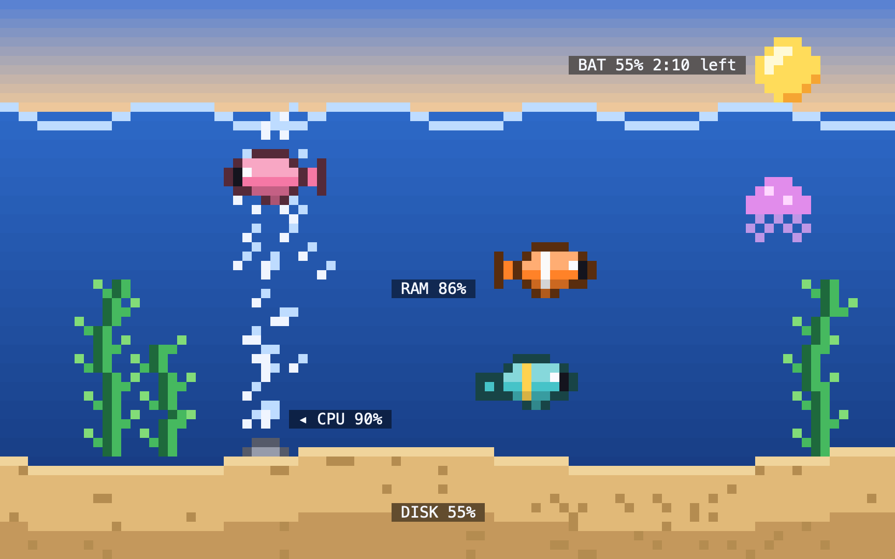
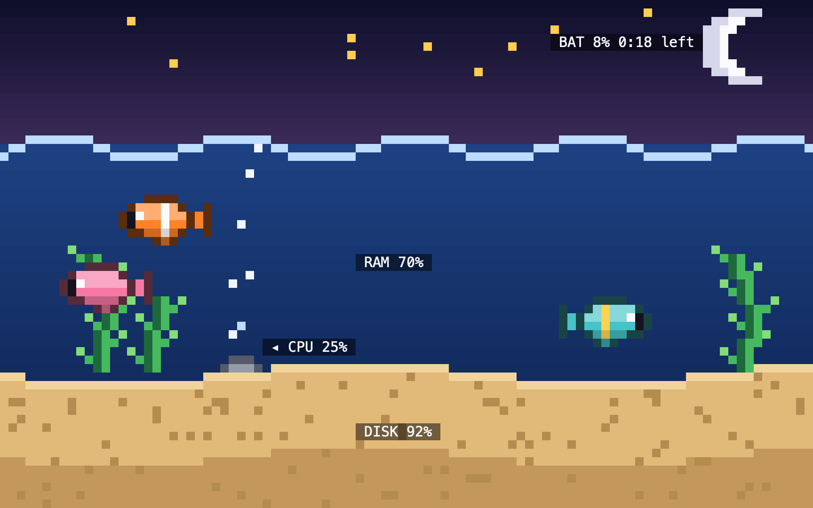
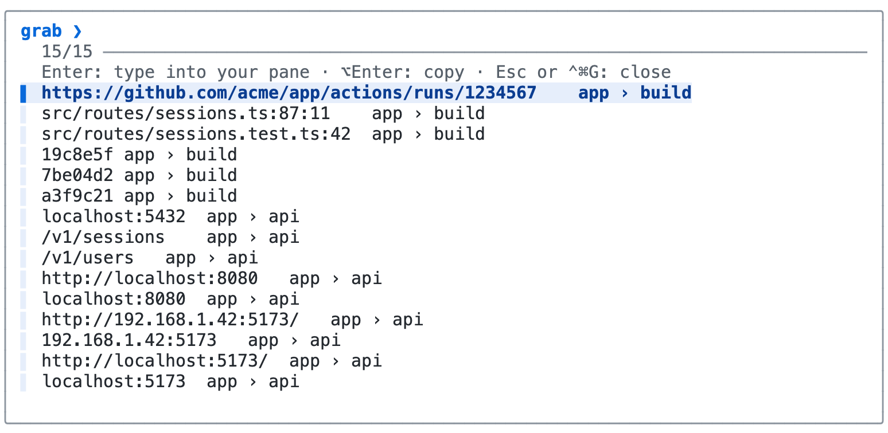
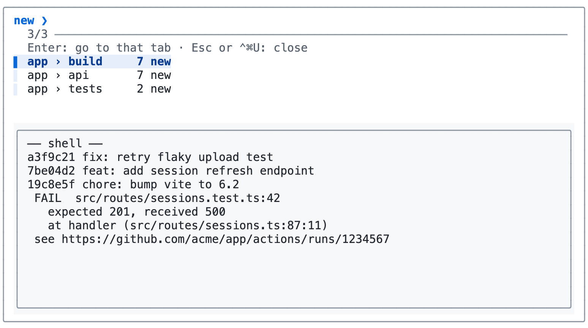

# rex-addons

Small add-ons for the [Rex](https://www.superlogical.com/rex) terminal.

## Aquarium (Ctrl+Cmd+A)

A pixel-art fish tank that floats over your tab and **reacts live to your Mac's state**. Every part of the scene is tied to a reading and changes as that reading changes:

- **Bubble column = CPU.** A lone bubble when idle, a wide roaring column under load.
- **Water level = RAM.** The tank fills as memory fills. A jellyfish drifts in above 80%.
- **Sand depth = disk.** Storage piles up on the tank floor.
- **Time of day = battery.** Bright day when full, golden as it drains, then sunset and night with a moon below 15%. Sun rays mean it's charging.

The same tank under three simulated states:

**Calm:** charging at 90%, CPU 6%, RAM 45%, disk 30%



**Busy:** CPU 90%, RAM 86%, battery at 55%



**Running low:** battery at 8%, disk 92% full



CPU use on a MacBook Neo, as a share of one core:

| State | CPU |
|---|---|
| Visible, at about 7.7 fps | ~5% |
| Idle: no activity for 45 seconds, so it drops to a tenth of the frame rate | ~1% |
| Hidden behind another tab | ~0.1% |

To open it in its own tab instead of a float, run `rex do aquarium/aquarium.lua`. To preview any state, run `rex do aquarium/aquarium.lua debug=true cpu=90 mem=86 bat=55 ac=false disk=55 shot=/tmp/tank.ans`.

## Grab (Ctrl+Cmd+G)

A picker for every URL, file path, `host:port`, IP and git hash visible on any pane in any session. **Enter** types the pick into the pane you're in, **Option+Enter** copies it.



## What's New (Ctrl+Cmd+U)

"Unread" output for terminals. Tabs whose panes printed something since you last looked get a `● ` mark. What's New lists them with just the new lines, and **Enter** jumps to the tab. Needs the watcher running: `rex do unread/unread.lua`. To remove every mark, run `rex do unread/unread.lua clear=true`.



## Mood (experiment)

`mood/` tints each pane's background by its state (failed command, idle). The Rex app doesn't show per-pane `set_theme` colors yet, so it has no visible effect today.

## Setup

In `~/.config/rex/init.lua`:

```lua
REX_ADDONS = "/path/to/rex-addons"
dofile(REX_ADDONS .. "/init.lua")
```

Then run `rex config reload`.

`aquarium/NOTES.md` covers how the aquarium works and the Rex quirks found along the way: the floating-layer bounds bug, Lua pattern and table-key gotchas, and the action deadlock.
